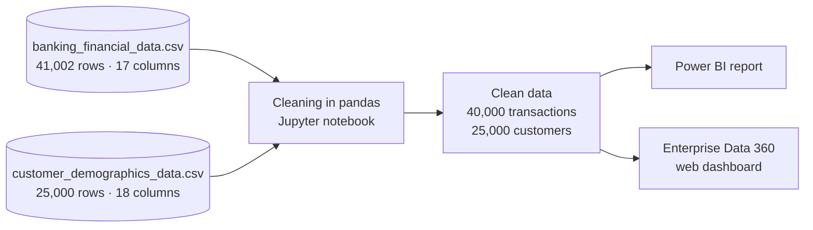

# Data-Analysis-Project

  

**Live dashboard: https://husseinhany.github.io/Data-Analysis-Project/**
Graduation Project: Data Cleaning

This project focuses on cleaning and preparing two datasets as part of a graduation project. The cleaning steps are documented in the Graduation_Project_Cleaning(Finished).ipynb Jupyter Notebook.

## From raw data to dashboard

## Cleaning results

| Dataset | Rows in | Problem found | What was done | Rows out |
| --- | --- | --- | --- | --- |
| Banking transactions | 41,002 | 1,002 rows with no `Transaction_ID` | Dropped, since a transaction can't be traced without its ID | **40,000** |
| Customer demographics | 25,000 | 49 missing `Annual_Income` values | Filled with the column average, $114,825.46 | **25,000** |
| Both | | Duplicate rows | None found; `drop_duplicates()` run as a final check | |

What's in this repository

| File | What it is |
| --- | --- |
| `Graduation_Project_Cleaning(Finished).ipynb` | The data cleaning notebook described below |
| `Graduation Project.pbix` | The Power BI report (open with Power BI Desktop) |
| `WEBSITE.html` | "Enterprise Data 360", an interactive dashboard with seven sections (overview, banking, e-commerce, inventory, HR, marketing, customer 360): animated charts, light and dark themes, search across the tables, sortable columns, a table view for every chart, and CSV export. The figures are sample data. Live at https://husseinhany.github.io/Data-Analysis-Project/ |
| `DOCUMENTATION.pdf` | The written project documentation |
| `Github.txt`, `Website.txt` | Links to this repository and to the live dashboard |
| `index.html` | Sends visitors of the live address to `WEBSITE.html` |

The two CSV datasets are not included in this repository, so the notebook cannot be re-run without them.

Datasets Used

banking_financial_data.csv: Contains financial transaction data.

customer_demographics_data.csv: Contains demographic information about customers.

Dependencies

The cleaning process primarily uses the pandas library in Python.

Cleaning Process

1. Banking Financial Data (banking_financial_data.csv)

This dataset was loaded into a pandas DataFrame named df1.

Initial Inspection: The data was inspected using .shape, .info(), and .describe() to understand its structure and identify preliminary issues.

Missing Data:

df1.isnull().sum() revealed 1002 missing values in the Transaction_ID column.

Action: All rows containing any missing values were removed using df1.dropna().

Duplicate Data:

df1.duplicated().sum() was used to check for duplicate rows. No duplicates were initially found.

Action: df1.drop_duplicates() was run as a final measure to ensure no duplicates remained after cleaning.

2. Customer Demographics Data (customer_demographics_data.csv)

This dataset was loaded into a pandas DataFrame named df2.

Initial Inspection: The data was inspected using .shape, .info(), and .describe().

Missing Data:

df2.isnull().sum() revealed 49 missing values in the Annual_Income column.

Action: Missing Annual_Income values were imputed using the mean of the column (df2['Annual_Income'].fillna(df2['Annual_Income'].mean())).

Duplicate Data:

df2.duplicated().sum() was used to check for duplicate rows. No duplicates were found.

Summary

After these steps, both DataFrames (df1 and df2) are cleaned of missing values and duplicates, making them suitable for further analysis.
